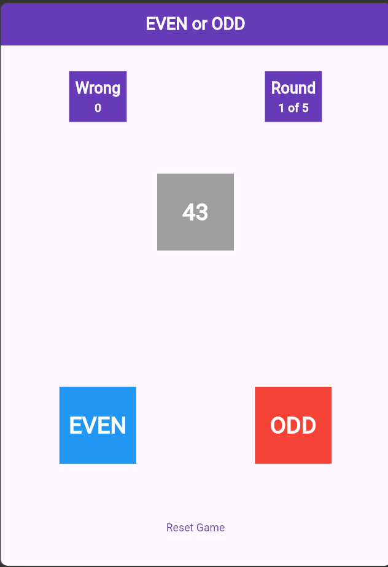
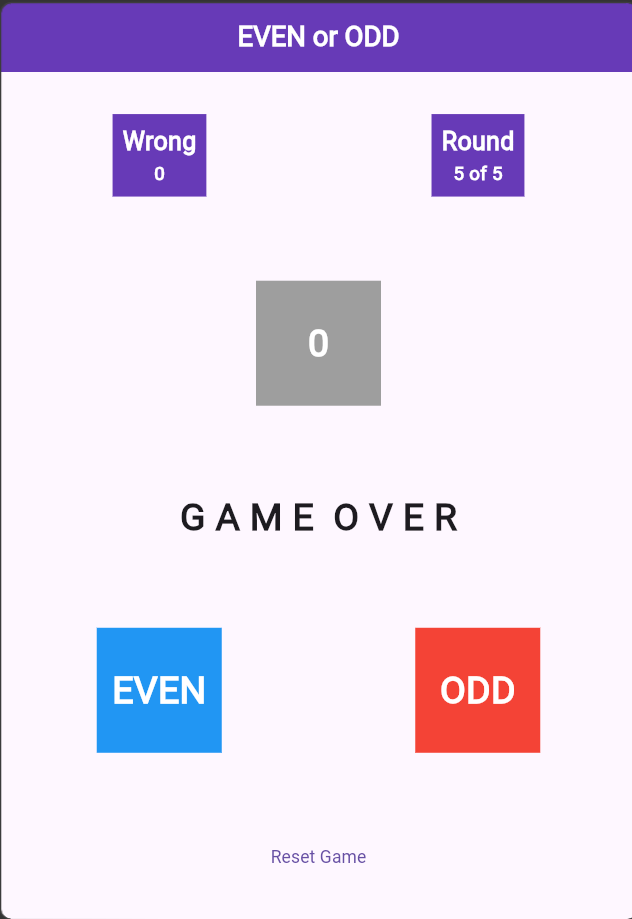

# Flutter Even or Odd Game

A simple interactive number game built with **Flutter** and **Dart**. Players drag randomly generated numbers into the correct EVEN or ODD target and receive instant feedback.

## Features

- Random number generation
- Drag-and-drop gameplay using Flutter's `Draggable` and `DragTarget` widgets
- Instant feedback for correct and incorrect answers
- Round tracking
- Wrong-answer counter
- Game-over and winning conditions
- Reset game functionality

## Screenshots

<!-- Add your screenshots here -->

| Gameplay | Game Over |
|:---:|:---:|
|  |  |

## Built With

- [Flutter](https://flutter.dev/)
- [Dart](https://dart.dev/)
- Material Design

## How to Play

1. A random number appears on the screen.
2. Drag the number to the **EVEN** or **ODD** target.
3. Receive feedback based on your answer.
4. Complete all five rounds to win.
5. Be careful: three incorrect answers end the game.
6. Press **Reset Game** to start a new round.

## Getting Started

### Prerequisites

- Flutter SDK
- Dart SDK
- Android Studio or Visual Studio Code

### Installation

1. Clone the repository:

   ```bash
   git clone https://github.com/ARK13-org/flutter-even-odd-game.git
   ```

2. Navigate to the project directory:

   ```bash
   cd flutter-even-odd-game
   ```

3. Install dependencies:

   ```bash
   flutter pub get
   ```

4. Run the application:

   ```bash
   flutter run
   ```

## What I Learned

This project helped me practice Flutter fundamentals, including:

- Stateful widgets and state management with `setState()`
- Drag-and-drop interactions
- Working with lists and random number generation
- Conditional rendering
- Handling user interactions and game logic

## Author

**ARK13**

GitHub: [ARK13-org](https://github.com/ARK13-org)
