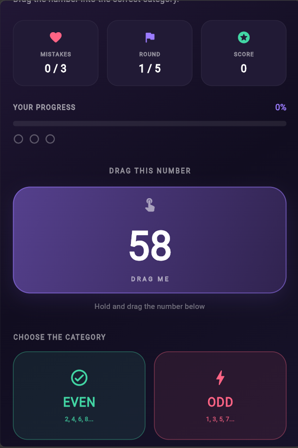
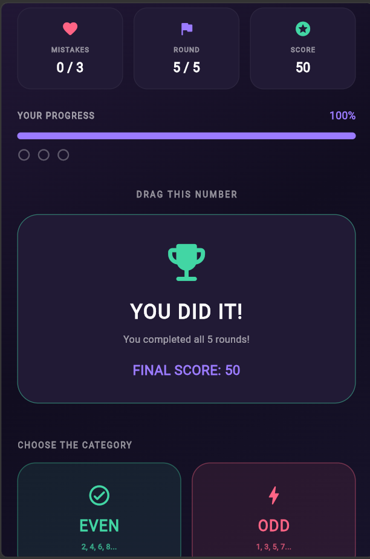
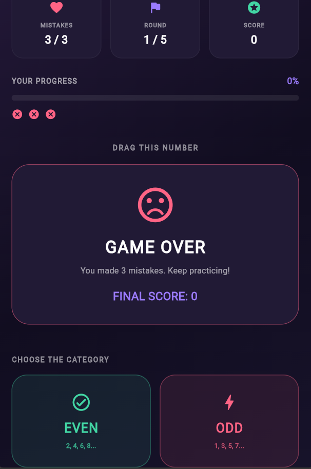

# 🎮 Even or Odd – Flutter Game

A fun and interactive number-classification game built with **Flutter** and **Dart**. Test your skills by identifying whether numbers are even or odd through an engaging drag-and-drop experience.

## 📸 Screenshots

### Gameplay


### Victory Screen


### Game Over Screen


## ✨ Features

- **Interactive Drag & Drop:** Drag numbers into the correct EVEN or ODD target.
- **5 Rounds:** Complete five rounds to win the game.
- **Score Tracking:** Keep track of your progress and score.
- **Mistake Limit:** You have three mistakes before the game ends.
- **Progress Indicator:** Follow your progress throughout the game.
- **Victory & Game Over Screens:** Get feedback based on your performance.
- **Restart Option:** Play again whenever you want.
- **Modern UI:** Enjoy a polished dark-themed interface.

## 🛠️ Built With

- [Flutter](https://flutter.dev/) – UI framework
- [Dart](https://dart.dev/) – Programming language

## 🚀 Getting Started

### Prerequisites

Make sure you have installed:

- Flutter SDK
- Dart SDK
- Android Studio or Visual Studio Code

### Installation

1. Clone the repository:

   ```bash
   git clone https://github.com/ARK13-org/Flutter-Even-Odd-Game.git
   ```

2. Navigate to the project directory:

   ```bash
   cd Flutter-Even-Odd-Game
   ```

3. Install dependencies:

   ```bash
   flutter pub get
   ```

4. Run the application:

   ```bash
   flutter run
   ```

## 🎯 How to Play

1. A number appears on the screen.
2. Drag the number card to the appropriate target:
   - **EVEN** – If the number is divisible by 2.
   - **ODD** – If the number is not divisible by 2.
3. Complete all five rounds to win.
4. Be careful! Three mistakes will end the game.
5. Restart and try to improve your performance.

## 📂 Project Structure

```text
numbers_game/
├── android/
├── ios/
├── lib/
├── test/
├── assets/
│   └── screenshots/
│       ├── gameplay.png
│       ├── victory.png
│       └── game_over.png
├── pubspec.yaml
└── README.md
```

## 👨‍💻 Author

**ARK13-org**

GitHub: [@ARK13-org](https://github.com/ARK13-org)

---

⭐ If you like this project, consider giving it a star!
